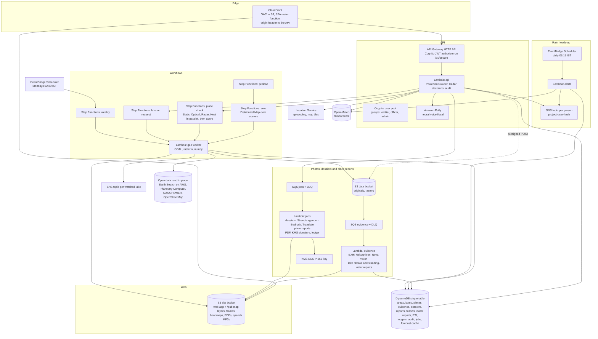

# Architecture

JalSmriti is one AWS SAM template (`infra/template.yaml`) deployed by `deploy.py`. Everything is serverless and pay
per use; nothing runs when nobody uses the site, except a daily rain check and a weekly satellite check.

## Requests

- **Public reads** (`/v1/areas`, `/v1/lakes/{id}`, `/v1/dossiers/{id}`, `/v1/verify/{id}`, ledgers, RTI records,
  geocoding, `/v1/forecast`, `/v1/reports/{id}`, `/v1/waterlogging`, `/v1/waterlogging/near`) go CloudFront to API
  Gateway to the API function. Map layers, frames, heat maps, PDFs and speech are static files under `/pub/` served
  from S3 through CloudFront.
- **Public actions** that need no account: a place check (`POST /v1/places`), a lake analysis (`POST /v1/lakes/find`),
  a signed place report (`POST /v1/places/report`) and a narration (`POST /v1/speech`). Each is bounded by
  per-address and site-wide daily limits.
- **Signed-in actions** (`/v1/secure/...`) carry a Cognito ID token. API Gateway checks the JWT; the API function then
  asks Cedar whether this person may do this to this lake, photo, report, area or dossier, writes the decision and the
  deciding policy to the area's audit log, and refuses with the rule's plain text if denied. They include photos,
  dossiers, watches, following a place and the test email, recording an RTI request, reporting standing water and the
  console's reviews and responses.
- **Only CloudFront reaches the API.** CloudFront adds a stack-unique header to every API request and the function
  refuses requests without it, so per-address limits use the address CloudFront saw, not one a caller made up.
- **Limits.** Per address or account per day, and site-wide daily caps on the satellite work, reports, narrations,
  standing-water reports and forecasts anyone can start (see [cost](cost.md)).

## Satellite work

- **Area run** (`area.asl.json`): prepare the area grid and the list of post-monsoon scenes from 1987, then in
  parallel (a) a Distributed Map that reads each scene (water mask per lake, time-lapse frames) and (b) one chain of
  static layers (JRC history, land cover, terrain, rain), the latest Sentinel-2 look, radar flood events and lake
  names. Then aggregate: grades, findings, the lakes GeoJSON and the area manifest. Map concurrency comes from the
  account's Lambda limit, so a new account with 10 concurrent runs still finishes, more slowly.
- **Place check** (`place.asl.json`): four branches in parallel, each a geo-worker task that writes its part to the job
  record as soon as it finishes, so the page fills in live:
  **Static** (water history, land cover, terrain), **Optical** (time-lapse frames), **Radar** (monsoon sightings) and
  **Heat** (Landsat 8/9 summer surface temperature around the place, with a heat map). Optical, Radar and Heat may
  fail without failing the check. Then **Score** computes the water memory and findings and stores the result by
  geohash (about 150 m) and cache version for 90 days.
- **Lake on request** (`lake.asl.json`): find the water body at a point from JRC, read its looks, static layers and
  latest look in parallel, then grade it.
- **Weekly** (`weekly.asl.json`): refresh each area's latest look and check every watched lake; a change is
  published to that lake's SNS topic, which emails the people watching it.
- **Preload** (`preload.asl.json`): runs the nine area runs one after another after a deploy.

Satellite data is never copied: GDAL reads windows of cloud-optimised GeoTIFFs over HTTPS (Sentinel-2 L2A and the
Copernicus DEM from Earth Search on AWS in us-west-2; Landsat, including its surface temperature band, Sentinel-1 RTC,
JRC Global Surface Water and land cover from Microsoft Planetary Computer with anonymous SAS tokens).

## Photos, dossiers and place reports

1. The browser asks for an upload slot; the API returns a presigned POST limited to one key, JPEG/PNG/WebP and
   12 MB, and the photo goes straight to the private data bucket: `evidence/{lake}/` for a lake photo,
   `evidence/waterlogging/` for a standing-water report.
2. S3 notifies SQS; the evidence function fingerprints the original (SHA-256), reads EXIF time and GPS, screens the
   photo with Rekognition moderation, blurs faces and writes a public copy without metadata.
   - A lake photo's GPS is checked against the lake outline, Amazon Nova describes it in fixed categories, and a
     ledger entry is appended.
   - A standing-water report takes its place from the photo's GPS or the phone's location (flagged when they are more
     than 2 km apart), and Amazon Nova says whether standing water is visible and how deep. It goes on the live map at
     once, unless Nova is confident there is no water, in which case it waits for a verifier.
3. A verifier reviews it in the console; Cedar requires the verifier's jurisdiction and a note, and forbids reviewing
   one's own upload or report.
4. A dossier request goes to SQS. The jobs function builds the facts from the stored metrics, runs a Strands agent on
   Amazon Nova with three read-only tools (lake facts, evidence summary, recipient and laws), rejects any draft with
   a number that is not in the facts, translates it (numbers checked again), renders the PDF with HarfBuzz shaping
   for Indic scripts, signs an attestation of the content and PDF hashes with KMS (`ECDSA_SHA_256`), and appends
   to the ledger.
5. A place report request goes to the same queue. The jobs function reads the stored place check, its frames and heat
   map, and the standing-water reports within 1 km, writes the PDF in the reader's language for the chosen reader
   (renting or buying, or living there), and signs an attestation of the content and PDF hashes with the same key.
   The report id is derived from the check, language and reader, so a repeated request returns the same PDF.
6. Anyone can open `/verify/{id}` (a dossier, or a report id starting `rpt`): the browser verifies the signature with
   Web Crypto against the public key, and hashes a dropped or downloaded PDF to compare with the signed hash.

## Rain heads-up

1. A signed-in person with a confirmed email follows a place (up to 10). The API stores the follow with the place's
   water-memory tier and the person's language, creates their own SNS topic (`<project>-user-` and a hash of their
   account id) and subscribes their email once.
2. Every day at 06:15 IST, EventBridge Scheduler invokes the alerts function. It reads all follows, groups them by
   5 km forecast cell, asks Open-Meteo for up to 50 cells per request, caches each forecast for an hour (the website
   shares the cache), and checks today and tomorrow against the place's threshold: IMD heavy rain (64.5 mm a day)
   everywhere, less where the place has a water memory.
3. A due heads-up is written in the follower's language and published to their topic. A rainy day is announced once
   per place and a place gets at most one email a day, so a retry sends nothing new. Each heads-up is written to the
   area's audit log.
4. "Send me a test email" publishes a heads-up for the wettest coming day at once, marked as a test.

The place page shows the next three days from the same cached forecast, with a warning when today or tomorrow crosses
the place's threshold.

## Listening

`POST /v1/speech` builds the spoken text for a place (with up to three of this week's steps for the chosen reader) or
a lake, in Hindi or English, and checks whether `/pub/speech/<hash>.mp3` already exists. If not, Amazon Polly
(neural voice Kajal) synthesizes it once and the API stores it with an immutable cache header; CloudFront serves every
replay.

## Data model (one DynamoDB table)

| Item | PK | SK | Notes |
|---|---|---|---|
| Area | `AREA#{id}` | `META` | status, stage, stats, manifest URL |
| Lake row in an area | `AREA#{id}` | `LAKE#{lakeId}` | list and sort in Explore |
| Lake | `LAKE#{lakeId}` | `META` | geometry, metrics, findings, frames; GSI1 by area and grade |
| Place check | `PLACE#{geohash7}` | `V#{cache version}` | cached result, with summer heat; TTL 90 days |
| Job | `JOB#{id}` | `META` | place or lake job progress, TTL 7 days |
| Evidence | `EVID#{id}` | `META` | GSI1 by lake, GSI2 by uploader, GSI3 review queue by area |
| Dossier | `DOSS#{id}` | `META` | letter, translation, hashes, signature, timeline; same GSIs |
| Place report | `RPT#{id}` | `META` | reader, language, payload, hashes, signature, PDF URL; TTL 400 days |
| Follow | `FOLLOW#{userId}` | `{geohash7}` | place, tier, language, last heads-up; GSI2 by user, GSI3 `FOLLOWS` for the daily check |
| Heads-up subscription | `USERSUB#{userId}` | `META` | the person's SNS topic and subscription, status |
| Forecast | `FCST#{geohash5}` | `META` | Open-Meteo forecast for a 5 km cell; TTL 1 hour |
| Standing-water report | `WLOG#{id}` | `META` | GSI1 `WLGEO#{geohash4}` by time seen, GSI2 by uploader, GSI3 review queue by area |
| Standing water by day | `WLDAY#{yyyymmdd}` | `{seenAt}#{id}` | public copy for the live map |
| RTI request | `RTI#{id}` | `META` | office, filed and due dates, reference; GSI1 by lake, GSI2 by person |
| Ledger | `LEDGER#{lakeId}` | `00000001` ... and `HEAD` | hash chain; appends are DynamoDB transactions |
| Watch | `WATCH#{lakeId}` | `USER#{sub}` | subscription ARN and status |
| Audit | `AUDIT#{area}` | `{time}#{random}` | action, actor pseudonym, role, decision, policies; TTL 400 days |
| Rate limit | `RATE#{who}#{day}` | action | conditional counter, TTL 2 days |

## Security

- Least-privilege IAM per function (for example, the API may only `PutObject` under `evidence/` in the data bucket,
  only the jobs function may use the KMS key to sign, and only the API and the alerts function may publish to the
  per-person topics `<project>-user-*`).
- Both buckets block public access; CloudFront reads the site bucket with origin access control.
- The signing key is an asymmetric KMS key: the private half cannot leave KMS.
- Cognito: email sign-up with a 10-character password policy; email changes take effect only after verification;
  alert and heads-up emails go only to verified addresses, and SNS asks each address to confirm.
- People appear under pseudonyms; faces are blurred and metadata stripped in public copies; originals stay private.
  Standing-water reports are published at about 11 m precision; the exact position, the photo's metadata and the
  uploader's account id stay private. Per-person topic names are hashed, so they say nothing about the person.
- `deploy.py` keeps the access key in memory only.

## Observability

A CloudWatch dashboard (Lambda invocations and errors, including the alerts function; workflow outcomes; API latency
and 5xx; queue depths), alarms on API errors and on both dead-letter queues, X-Ray tracing on all functions, and log
groups kept for 30 days.
