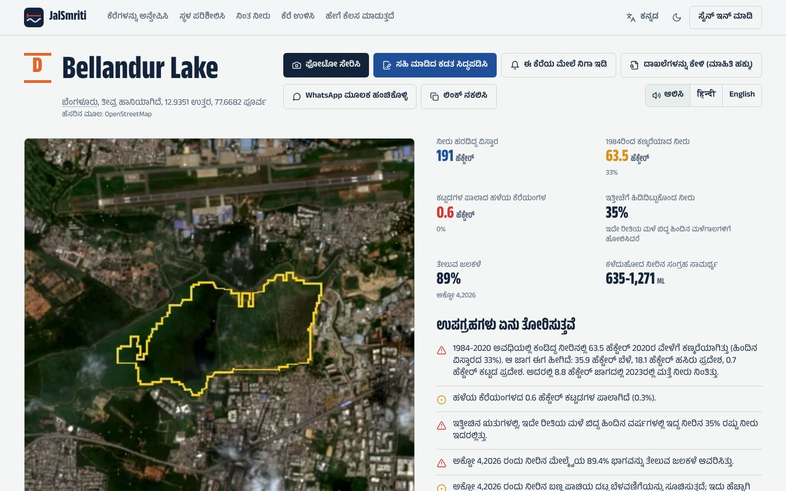

# Water remembers: building JalSmriti on AWS

*By Ansh Singhal. Draft for AWS Builder Center.*

When Bengaluru flooded in September 2022, the worst-hit layouts along Sarjapur Road and in Mahadevapura sat on what
used to be the beds and channels of the city's tanks. Chennai in 2015 and Hyderabad in 2020 told the same story:
the monsoon goes back to where water lived. The record of where that was exists, in forty years of free satellite
images, but it is locked in formats only remote-sensing specialists read.

JalSmriti ("water remembers" in Hindi and Sanskrit) is my attempt to open that record to the people who need it: a
family choosing where to rent, a resident before the monsoon, a lake group fighting encroachment, an officer who has
to answer a complaint. The hackathon framed the missing step as the moment "where a number turns into something a
person can act on this week", and the newer parts of JalSmriti are about that step. This post is about how it is
built and what I learned building it on AWS.

## What it does

- **Check a place**: any locality in India or Nepal gets a "water memory" (strong, some or little) from five terrain
  and history signals, a time-lapse since 1990, every monsoon radar pass since 2017 that saw unusual water, how hot
  the ground gets on summer mornings, and the rain forecast for the next three days.
- **What to do this week**: up to seven steps for that place, one list for someone about to rent or buy and one for
  someone who lives there.
- **Our read**: four quick answers (renting or buying, which floor, a car in basement parking, elderly people or small
  children at home) turn the check into a plain verdict, from "Look elsewhere" to "Good to go", with the reasons.
- **A signed place report**: the check and the steps as a PDF in the reader's language, signed with AWS KMS and
  verifiable in any browser; it can also be read aloud in Hindi or English by Amazon Polly.
- **Rain heads-up**: follow a place and get an email when heavy rain is forecast there.
- **Report standing water**: a photo on a live map, checked for privacy and by Amazon Nova, confirmed by NGO
  verifiers.
- **Explore lakes**: nine areas read in full, 1,138 water bodies graded A to E from water held after each monsoon,
  old bed built over, floating weeds and water lost since 1984, each with its likely causes, what would help and recent
  news that names it.
- **Defend a lake**: verified photo evidence, an AI-drafted letter in 13 languages of India and Nepal, a PDF signed
  with AWS KMS, a Right to Information request for the lake's records, and a hash-chained ledger of everything that
  happens to the lake.

The interface speaks English, Hindi, Kannada, Tamil, Telugu, Malayalam and Nepali, and the same site works on a
phone, a tablet or a laptop; on touch screens every control is at least 44 px.

## Reading forty years of satellites without copying them

Each area is a Step Functions state machine. A Distributed Map fans out over 57 to 77 post-monsoon scenes since 1987
(Landsat until 2015, Sentinel-2 after), each read by a Lambda function with GDAL that pulls only the needed windows
of cloud-optimised GeoTIFFs over HTTPS: Sentinel-2 and the Copernicus DEM from Earth Search on the Registry of Open
Data on AWS, Landsat and Sentinel-1 from Microsoft Planetary Computer. Nothing is copied. Next to the map, one chain
computes the JRC historic-water layers, land cover, terrain, NASA POWER rainfall, radar flood maps and names, and an
aggregate step grades every lake.

A single place check is a smaller workflow: four branches in parallel (static layers, optical frames, radar, summer
heat), each writing its part to the job record as it finishes so the page fills in live, then a score. Only the
static branch is required; if the optical, radar or heat branch fails, the check still answers.

Two things mattered more than I expected:

1. **New accounts are small.** A new AWS account may allow 10 concurrent Lambda runs and 3,008 MB of memory. The
   deploy script reads the limit and sets the map's concurrency from it, and the side work runs as one chain so an
   area never asks for more than it can get.
2. **Honest seasons.** Comparing a lake with itself only in years of similar monsoon rain (within 25%) turned "the
   lake is smaller" into "the lake holds less water than it used to with the same rain", which is what a grade
   should say.

## Radar that knows what season it is

Sentinel-1 radar sees through monsoon cloud, but flooded paddy fields look like floods every August. JalSmriti
compares each pass with passes on the same orbit in other years within 20 days of the same date, and only calls
water "unusual" when it is at least 3 dB darker than that baseline. In Sivasagar the August 2026 pass shows about
2,400 ha of such water around the town.

## Is the "water memory" real?

I collected 39 localities that were reported flooded in widely covered events in Bengaluru, Chennai, Hyderabad and
Delhi-NCR, and compared them with 240 random built-up places. A flooded locality scores higher 68.5% of the time
(AUC 0.685); 15% of flooded localities had little water memory against 43% of random places. It is strong in
Bengaluru (0.85) and on Delhi's Yamuna floodplain (0.78), and weak in Chennai and Hyderabad, where extreme rain and
breached lakes flooded far beyond old water beds. The site says exactly that, and never calls the index a forecast.

## From a number to this week's steps

A score of 79 out of 100 does not tell a family what to do on Saturday. So every place check now ends with steps,
built by fixed rules from the stored check rather than by a language model. Radar dates become questions ("Radar saw
standing water near here on these days. Ask about those days in particular."). Strong water memory, ground less than
a metre above a drainage line or a hollow a metre deep add advice on floors, basements and plinths. Old lake beds
built over nearby add a check of the land's survey number against the village map and the lake's full tank level.
Summer ground of 42 °C or more adds advice on shade and roofs. A list holds at most seven steps.

What I learned: write every sentence once. Each step is a dictionary key with variables, and the website, the signed
PDF, the narration and the rain email all turn keys into words in the reader's language. A small script copies the
words the server needs from the website's dictionaries, and the i18n check fails if that copy is out of date, so the
page and the PDF cannot drift apart.

## Lost lakes, hotter streets

The same lost lakes make neighbourhoods hotter. Landsat 8 and 9 measure the temperature of the ground surface (band
ST_B10), so a place check reads the clearest passes between 15 March and 31 May of the last three summers, keeps up
to eight, and takes each pixel's median. "Here" is the median within 300 m, compared with built-up ground, trees and
lasting lake water in a 6 km window. In my run for Bellandur in Bengaluru, the ground measured 41.1 °C on summer
mornings against 40.4 °C for built-up ground, 37.4 °C under trees and 31.8 °C for lake water nearby.

Two lessons. In clear-sky places dozens of passes have no cloud at all, so "least cloudy first" could take every pass
from the latest summer or the hottest weeks; giving equally clear passes to the summers in turn, nearest mid-season
first, spreads the sample over all three. And the thermal
pixels are 100 m across, so a pond smaller than that reads warm: the page says it measures the surface at about
10:30 in the morning, not the air, and that afternoons are hotter.

## A heads-up before heavy rain

Every morning at 06:15 IST, an EventBridge Scheduler schedule runs a Lambda function that reads every followed place,
fetches the Open-Meteo forecast once per 5 km cell (up to 50 cells in one request) and checks today and tomorrow. Rain
is graded with the India Meteorological Department's categories. Every place gets a heads-up for heavy rain (64.5 mm
in a day); a place with strong water memory gets one from 35 mm in a day or 15 mm in an hour, and one with some water
memory from 50 mm or 20 mm. These are working thresholds, not fitted to flood records, and the email says that
official warnings from IMD and NDMA come first.

What I learned about SNS: one topic per person, not per place. The person confirms one subscription, however many
places they follow, and topic names are a hash of the account id. CreateTopic is throttled far below Publish, so on a
wet morning the function retries with adaptive backoff. And the job is safe to re-run: a rainy day is announced once,
and a place gets at most one email a day.

## Reports people can check, and hear

The place report is a PDF of one or two pages for the chosen reader, in their language, with our read when a family
renting or buying has given its four answers. Its id is derived from the check, the language, the reader and those
answers, so asking twice returns the same signed file. The jobs function signs an attestation of the content and PDF
fingerprints with the same KMS key as the dossiers, and the verify page checks it in the visitor's browser.

Drop the PDF on its verify page and the browser says whether it is the signed original:

Some people would rather listen than read, so place and lake reports can be read aloud by Amazon Polly with the
neural voice Kajal, which speaks both Indian English and Hindi. The audio is stored under a hash of the voice,
language and text and served by CloudFront, so each text is synthesized once however often it is played.

## Standing water from the street

Satellites miss water that drains in hours; people standing in it do not. A standing-water report goes through the
same pipeline as lake photos: a presigned POST to a private bucket, an SQS-triggered Lambda that fingerprints the
original, screens it with Amazon Rekognition, blurs faces and strips metadata. Amazon Nova then says whether standing
water is visible and how deep. That answer is a hint: a report goes on the map at once unless Nova is at least 60%
sure there is no water or Rekognition reads 25 or more printed words in the photo, and NGO verifiers confirm or reject
reports under Cedar rules that forbid reviewing your own.

## Evidence an office cannot wave away

Lake photos go from the phone straight to a private S3 bucket through a presigned POST. An SQS-triggered Lambda
fingerprints the original, checks EXIF GPS against the lake outline, screens it with Amazon Rekognition, blurs faces,
and asks Amazon Nova for a description in fixed categories. An NGO verifier confirms it.

The dossier is where the AWS open-source pieces meet:

- **Strands Agents** runs the letter-drafting agent on Amazon Nova, with three read-only tools that return the computed
  facts. Any number in a draft that is not in the facts sends it back; after repeated failures a plain template is
  used. Amazon Translate makes the second language, and the numbers are checked again.
- **AWS KMS** signs an attestation of the content and PDF fingerprints with an ECC P-256 key. The verify page imports
  the public key with the Web Crypto API and checks the signature in the visitor's own browser, and hashes the PDF to
  compare. The private key cannot leave KMS.
- **Cedar** decides every write with 16 written rules: verifiers review only in their areas and never their own
  uploads, officers respond only to dossiers that were actually submitted, and evidence is never deleted. Each
  decision is logged with the policy that made it, which turns the audit log into something a citizen can read.
- **Powertools for AWS Lambda** routes the API.

When a letter is not enough, a lake page drafts a Right to Information request for the lake's survey records,
encroachments, permits and works. Recording that it was filed adds it to the lake's ledger with the date a reply is
due: 30 days in India, 15 in Nepal.

## What the recent floods taught me

I went back to 16 places in India and Nepal that flooded between 2020 and 2026, or where families lost homes built on
old lake land. Among them are Velachery in Chennai after Cyclone Michaung, the Budameru floods in Vijayawada, Kendriya
Vihar in Bengaluru (flooded in 2021, then again in 2024), and Nakkhu and Balkhu in the Kathmandu Valley. Every one
shows at least one warning sign. The water history ends in 2020, so a family could have seen those signs before most
of these floods. That does not prove anyone would have been saved.

A family about to sign needs a plain answer, not a score. So the place page now gives "Our read". Four quick answers
and fixed points from the stored check give "Look elsewhere", "Think twice", "Fine, with checks" or "Good to go", with
the reasons and what to do if you still like the place. For a family renting a ground-floor flat, the 16 places read
13 "Think twice", 1 "Look elsewhere" and 2 "Fine, with checks". For a buyer of a ground-floor flat with a car in
basement parking, they read 11 "Look elsewhere" and 5 "Think twice". The fair test is the validation set. Our read
warns at 82% of the 39 flooded localities, but also at 53% of the 240 random built-up places, and "Look elsewhere" is
three times as common at the flooded ones (15% against 5%). So a warning means "check before you sign", not "never
live here", and the page says so.

Two smaller changes make the lake record easier to trust and to use. A vision model told that an upload is lake
evidence can be talked into seeing a lake. Amazon Rekognition's word count and labels cannot, so they now decide
first, and Nova's own answer on whether it is a real photo taken at the lake counts when Nova is sure. A screenshot,
poster or indoor photo stays private, with the reason. Photos already waiting for a verifier are re-checked at the
next deploy; one that fails is withdrawn with a ledger entry that says why. And every water body now has a name. One
that no map names is called after what is near it, such as "Water body near Bellandur Lake", because nobody writes to
an office about "Unnamed water body".

## One command, about a dollar a month

`python3 deploy.py` checks the account (including free-plan credits and the Polly voice), builds the Lambda layers on
a Mac from pinned Linux wheels, packs the workflows, deploys one SAM template, uploads the site, creates demo
accounts, reads the nine areas and smoke-tests the live site, including a rain forecast, a Hindi narration and a
signed Kannada place report. At demo traffic the bill is about 1 to 2 USD a month, mostly the KMS key; the preload
fits in Lambda's free allowance, and site-wide daily caps bound what anonymous visitors can start, from place checks
to narrations.

## Built with an AI coding assistant

I used Claude (Anthropic) as an AI coding assistant for code, documentation and the interface translations. The
translations into Hindi, Kannada, Tamil, Telugu, Malayalam and Nepali were machine-drafted and still need review by
native speakers. What kept the work honest was the test suite (207 tests with moto standing in for AWS) and the rule
that every number on the site comes from computed facts.

## What I would do next

Native-speaker review of every language; a test of the rain thresholds against standing water people actually
report, once there are enough reports; lake boundaries from revenue maps where they are public, so outlines can be
compared with the legal record; more cities; and working with lake groups to put the dossiers and RTI requests in
front of the offices that can act on them.

*JalSmriti is open source. Satellite data: JRC Global Surface Water, USGS Landsat, Copernicus Sentinel, Copernicus
DEM, Impact Observatory, ESA WorldCover, NASA POWER; weather data by Open-Meteo.com; names from OpenStreetMap and
GeoNames; news headlines found through Google News and the GDELT Project.*
